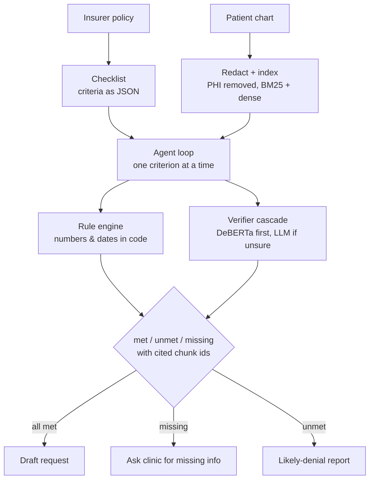

# AuthAgent

**Cost-aware agentic RAG for prior authorization, with a self-trained verifier cascade.**

An AI agent that checks insurer criteria against patient charts, cites evidence for every decision,
flags missing information before submission, and sends only uncertain checks to an expensive LLM.

> All patients and policies are **synthetic** and simplified. The policies are modeled on common
> criteria patterns; they are not any real insurer's policy and not clinical guidance.

---

## How it works



| Piece | What it does | File |
|---|---|---|
| Synthetic world | 45 patients across 3 policies, gold labels by construction, ~35% hard cases | `generator.py`, `domain.py` |
| PHI guard | Identifiers redacted; every LLM call is checked and refused if one leaks | `redact.py`, `llm.py` |
| Hybrid retrieval | BM25 (implemented here) + bge-small embeddings, fused with reciprocal rank fusion | `index.py` |
| Rule engine | Age, ICD-10 codes, lab thresholds and recency, drug-trial duration, all in code | `rules.py` |
| Agent loop | Plain-Python ReAct loop, JSON tool calls, retries on bad JSON, step cap, full trace | `agent.py` |
| Guardrails | Decisions must be backed by a tool result; "missing" needs two different searches; evidence only by real chunk id | `tools.py` |
| Context compaction | Finished criteria are summarized, so tokens per case stay roughly flat | `agent.py` |
| Verifier | DeBERTa-v3-small fine-tuned on generated pairs; temperature-calibrated; tested on an unseen policy | `scripts/train_verifier.py`, `verifier.py`, `calibrate.py` |
| Cascade | Local verifier answers when confidence ≥ τ; otherwise the LLM judges. τ is chosen on validation from the risk–coverage curve | `verifier.py` |
| Evaluation | Accuracy, false approvals, missing detection, citation precision, cost; bootstrap CIs; McNemar tests | `evaluate.py` |
| Serving | Gradio demo and FastAPI endpoint | `app.py`, `api.py` |

### Configurations compared

| Config | What it isolates |
|---|---|
| `single_prompt` | Whole chart + policy in one call. No tools, no agency |
| `fixed_pipeline` | Same tools in a fixed order: one search, one extraction or check. Tools without agency |
| `agent` | Tools + agency; every text check goes to the LLM judge |
| `agent_cascade` | Agent with the self-trained verifier first, LLM only when unsure |
| `agent_no_rules` (ablation) | No rule engine: the LLM judges numbers and dates itself |
| `agent_local_only` (ablation) | Local verifier only, never escalates |

### Metrics

- **Decision accuracy**: approve / pend / deny matches gold.
- **False-approval rate**: share of cases that should not be approved but were. The costly error.
- **Missing detection**: share of truly missing criteria flagged as missing.
- **Hard-criterion accuracy**: values at thresholds, stale labs, evidence only in notes, look-alike text, near-miss drugs.
- **Citation precision**: when a criterion is decided correctly, did it cite the right chart line?
- **Cost**: LLM calls, tokens and LLM latency per case; share of verifier checks sent to the LLM.
- 95% bootstrap confidence intervals; exact McNemar tests between configurations.

---

## Quickstart

### Colab (recommended; identical environment for everyone)
Open `notebooks/AuthAgent_colab.ipynb` in Colab and run the cells top to bottom. It clones or
unzips the repo, installs requirements, stores cache/results/models on Drive, reads your key
from Colab Secrets, trains the verifier on a T4 and runs every configuration.

**Kaggle** works the same way: turn Internet on in the notebook settings, add `LLM_API_KEY`
under Add-ons → Secrets, and read it with `kaggle_secrets.UserSecretsClient`.

### Local
```bash
uv sync --extra dev            # core + tests, pinned by uv.lock (Python 3.11)
uv sync --extra dev --extra ml --extra app   # + retrieval/verifier models + demo/API
cp .env.example .env           # add your provider, key and model
uv run python run.py selftest
```
Without `uv`: `pip install -r requirements.txt`.

### Commands
```bash
python run.py selftest                         # imports, data, rules, redaction, offline agent
python run.py case P-007 --config agent        # one case: full trace + output document
python run.py run --config all --limit 5       # smoke-test every configuration
python run.py run --config all                 # full evaluation (resumable)
python run.py run --config agent_no_rules,agent_local_only
python run.py report                           # results/report.md and report.json
python run.py retrieval                        # recall@k: BM25 vs dense vs hybrid
python scripts/train_verifier.py --compare-nli # GPU: train, calibrate, test on held-out policy
python run.py verifier-eval --verifier llm --limit 200   # LLM judge on the same pairs
python run.py demo --share                     # Gradio
python run.py api                              # FastAPI on :8000 (/docs)
```
Add `--llm mock` to any command to run fully offline with a scripted stand-in. The mock
exists to test the plumbing; its numbers are not results.

### Free LLM options
Any OpenAI-compatible endpoint works through `LLM_BASE_URL` / `LLM_API_KEY` / `LLM_MODEL`:
a free-tier inference API (Groq, OpenRouter free models) or Ollama running locally or in Colab.
Free tiers have rate and daily limits that change, so run `--limit 5` first and check. Every
response is cached in `cache/llm_cache.jsonl`; commit it and anyone can reproduce your exact
numbers with `AUTHAGENT_OFFLINE=1`, with no key and no network.

---

## Repository layout
```
run.py                      command line (selftest, run, report, demo, api...)
src/authagent/
  common.py domain.py generator.py     synthetic world and gold labels
  redact.py index.py rules.py          PHI guard, retrieval, rule engine
  llm.py mock_llm.py                   LLM client (cache, PHI guard, metering) and offline mock
  tools.py agent.py baselines.py       agent tools + guardrails, agent loop, baselines
  verifier.py calibrate.py             verifiers, cascade, temperature scaling, risk-coverage
  runner.py evaluate.py                experiment runner, metrics, CIs, McNemar, report
  service.py app.py api.py             demo and API
scripts/train_verifier.py   fine-tune + calibrate the verifier
data/policies/              3 policy checklists (JSON)
data/patients/              45 generated charts with gold labels
data/verifier_pairs/        train / val (RA, GLP-1) and test (held-out PCSK9) pairs
notebooks/                  Colab runner
tests/                      26 tests (rules, redaction, gold integrity, guardrails, agent, stats)
docs/project_flow.md        design, evaluation plan, timeline, likely panel questions
```

## Design decisions (and the question each one answers)
- **Why an agent, not a pipeline?** Evidence is often in free-text notes under different words
  ("QuantiFERON" for "TB screening"). The agent rephrases and looks again; the fixed pipeline
  cannot. The comparison measures exactly this.
- **Why code for numbers and dates?** LLMs misjudge thresholds and date windows. The LLM reads
  values; `rules.py` decides. `agent_no_rules` measures the difference.
- **Why a cascade?** Most verification checks are easy. A 140M-parameter model answers the ones it
  is confident about; only the rest go to the LLM. τ is set from data, not by hand.
- **Why "missing" instead of a guess?** Submitting with gaps causes denials and delays. The agent
  must search twice before concluding something is absent, and then it asks the clinic.
- **Why synthetic data?** Real charts are protected health information. Synthetic charts with
  known answers make every metric exact; the design transfers to real charts.

## Status
- Built and tested here: data generation, redaction, retrieval, rules, agent loop, guardrails,
  baselines, runner, metrics and statistics, API (all 26 tests pass; full offline runs work).
- To run on Colab: the verifier training script and the dense/NLI models, which need Hugging Face
  downloads, and all real-LLM runs. The notebook includes a 1-epoch smoke run before the full one.
