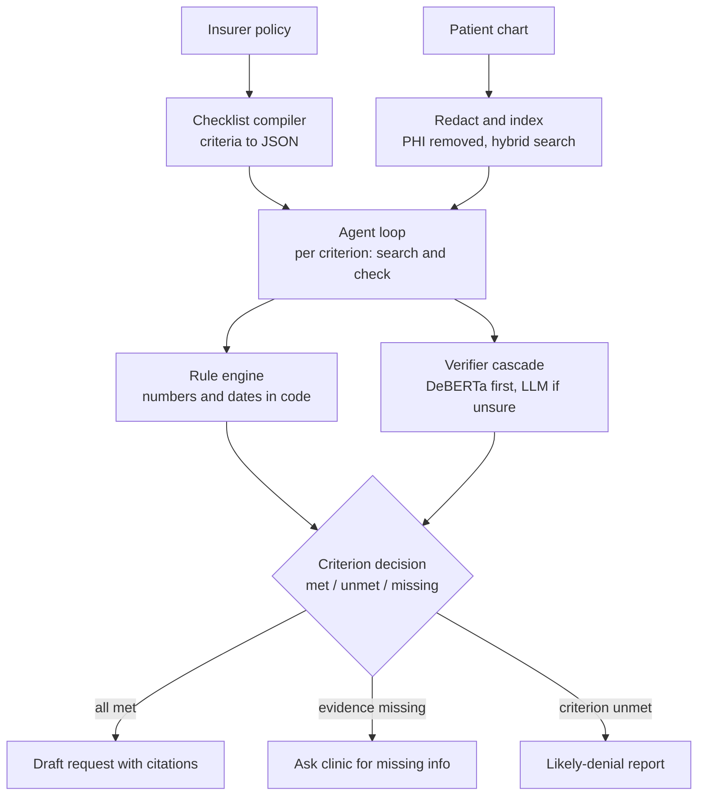
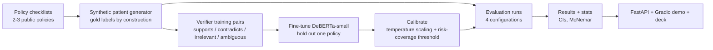

# AuthAgent

**Cost-Aware Agentic RAG for Prior Authorization with a Self-Trained Verifier Cascade**

> An AI agent that checks insurer criteria against patient charts, cites evidence for every decision, flags missing information before submission, and sends only uncertain cases to an expensive LLM.

---

## 1. Problem

In the US, insurers require **prior authorization (PA)** before covering many expensive drugs. The doctor's office (or a pharma patient-support hub) must prove the patient meets the insurer's criteria — diagnosis, prior therapies tried, lab values, required tests.

Today this is manual: staff read the policy, dig through the chart, and fill in forms. Missing information leads to denials and resubmissions, and patients wait days or weeks — some abandon therapy entirely.

## 2. Solution overview

Given an **insurer policy** and a **patient chart**, AuthAgent:

1. Turns the policy into a checklist of criteria.
2. Searches the chart for evidence on each criterion.
3. Marks each criterion **met / unmet / missing**, citing the exact chart line.
4. Drafts the PA request — or flags what's missing *before* submission.

What makes it more than a chatbot:

| Component | Role |
|---|---|
| **Agent loop** | LLM chooses its own tools, rephrases searches, abstains instead of guessing |
| **Hybrid RAG** | BM25 + embeddings over chart notes and records |
| **Rule engine** | Numbers and dates computed in code, never guessed by the LLM |
| **Self-trained verifier** | Fine-tuned, calibrated DeBERTa-small judges whether evidence supports a criterion |
| **Cascade** | Small model handles confident cases; only uncertain ones go to the LLM |
| **PHI guard** | Patient identifiers redacted before any LLM call |

---

## 3. Runtime flow (one case)



**Steps**

1. **Compile policy** — LLM converts the insurer policy into a JSON checklist (once per policy, cached, hand-verified).
2. **Prepare chart** — redact patient identifiers; index notes and structured records for hybrid search.
3. **Agent loop** — for each criterion, the agent decides where to search and reformulates if nothing is found (step cap enforced).
4. **Check evidence**
   - Numeric / date criteria → **rule engine** (deterministic code).
   - Text criteria → **DeBERTa verifier**; if confidence is below the calibrated threshold → **LLM judge**.
5. **Decide** — met / unmet / missing, each with a citation to the chart line.
6. **Output** — all met → draft request; anything missing → request missing items; any unmet → likely-denial report.

### Agent tools

| Tool | What it does |
|---|---|
| `get_checklist(policy_id)` | Returns the compiled criteria |
| `search_chart(query)` | Hybrid retrieval over notes + structured record lookup |
| `evaluate_rule(rule, values)` | Deterministic numeric / date evaluation |
| `verify_evidence(criterion, snippet)` | Verifier cascade (DeBERTa → LLM if unsure) |
| `draft_request(decisions)` | Builds the PA request with citations |

### Example trace (illustrative)

Patient P-017, rheumatoid-arthritis biologic policy:

1. `get_checklist("RA-biologic")` → 5 criteria
2. *"Methotrexate ≥ 90 days"* → `search_chart("methotrexate dates")` → start/stop dates → `evaluate_rule` → 112 days → **met**
3. *"Inadequate response documented"* → `search_chart("methotrexate response")` → nothing → agent rephrases → `search_chart("disease activity despite MTX")` → note: "persistent synovitis despite MTX" → `verify_evidence` → **met**
4. *"TB screening result"* → searches "TB test", "QuantiFERON / PPD" → nothing → **missing**
5. Decision: incomplete → no submission; request TB result from the clinic

---

## 4. Build & evaluation flow (before the demo)



1. **Data** — write 2–3 policy checklists (JSON, hand-verified). Generate ~45 synthetic patients from specs (criterion met / unmet / missing), so correct answers are known by construction. Some facts appear only in free-text notes; include hard cases: values near thresholds, date edge cases, missing documentation, contradicting notes.
2. **Verifier training** — the generator also emits thousands of labeled criterion–evidence pairs. Fine-tune DeBERTa-v3-small on Colab T4 (~20–30 min). Hold out one policy entirely for testing generalization.
3. **Calibration** — temperature scaling; reliability diagram; choose the escalation threshold from the risk–coverage curve.
4. **Evaluation** — run all configurations, compute metrics with bootstrap CIs and paired significance tests.
5. **Packaging** — FastAPI endpoint, Gradio demo, cached responses, tests, deck.

---

## 5. Evaluation design

### Configurations

| Config | What it isolates |
|---|---|
| **A. Single prompt** | Whole policy + chart in one prompt → approve/deny (no tools, no agency) |
| **B. Fixed pipeline** | Same tools, fixed order, no reformulation or early stop (tools, no agency) |
| **C. Agent** | Tools + agency |
| **D. Agent + cascade** | C with the self-trained verifier first, LLM only when unsure |

**Ablations:** remove the rule engine; remove the verifier.

### Metrics

- **Case level:** decision accuracy, **false-approval rate** (the costly error), missing-info detection recall
- **Criterion level:** accuracy, abstention rate
- **Verifier:** F1 on the held-out policy, expected calibration error (ECE); vs off-the-shelf NLI and LLM-as-judge
- **Retrieval:** recall@k for BM25 vs dense vs hybrid
- **Efficiency:** % of checks sent to the LLM, cost per case, latency (p50 / p95)

### Statistics

- Bootstrap 95% confidence intervals for every metric
- McNemar's test for paired comparisons between configurations

### Headline slide (template)

> "The agent cuts false approvals from X% to Y%. The cascade sends only Z% of checks to the LLM — N× cheaper and faster with no loss in accuracy."

---

## 6. Tech stack

| Layer | Choice |
|---|---|
| LLM | Open-weight models (Llama / Qwen) via free-tier API or local Ollama, through the `openai` client with a configurable `base_url` |
| Retrieval | `rank-bm25` + `sentence-transformers` (bge-small), CPU |
| Verifier | DeBERTa-v3-small fine-tuned with Hugging Face `transformers`; off-the-shelf NLI cross-encoder as baseline |
| Data | `pandas`, synthetic generator with fixed seed |
| Serving / demo | FastAPI, Gradio (shareable link from Colab) |
| Quality | `pytest`, response cache, per-request cost/latency logging |
| Environment | Colab / Kaggle primary; local via `uv` with committed lockfile |

## 7. Repo structure

```
authagent/
├── README.md
├── pyproject.toml / uv.lock
├── .env.example            # LLM_BASE_URL, LLM_API_KEY, LLM_MODEL
├── run.py                  # single entry point (+ --selftest)
├── data/
│   ├── policies/           # compiled checklists (JSON)
│   ├── patients/           # generated charts + gold labels
│   └── verifier_pairs/     # training / test pairs
├── src/authagent/
│   ├── llm.py              # client + response cache
│   ├── generator.py        # synthetic patients + verifier pairs
│   ├── checklist.py        # policy → JSON compiler
│   ├── redact.py           # PHI redaction
│   ├── index.py            # hybrid retrieval
│   ├── rules.py            # deterministic rule engine
│   ├── verifier.py         # DeBERTa verifier + calibration
│   ├── cascade.py          # verifier → LLM escalation
│   ├── tools.py            # agent tool definitions
│   ├── agent.py            # agent loop + trace logging
│   ├── baselines.py        # single prompt + fixed pipeline
│   ├── evaluate.py         # metrics, bootstrap CIs, McNemar
│   ├── api.py              # FastAPI
│   └── app.py              # Gradio demo
├── notebooks/
│   ├── 01_generate.ipynb
│   ├── 02_train_verifier.ipynb
│   └── 03_evaluate.ipynb
├── tests/
├── cache/llm_cache.jsonl   # committed → offline, reproducible reruns
└── results/
```

## 8. Reproducibility (runs on any teammate's machine)

- **Colab first:** share the notebook; "Run all" gives an identical environment.
- **Local:** `uv sync` from the committed lockfile; one pinned Python version.
- **No local LLM required:** avoids GPU / driver issues; Ollama is optional.
- **Deterministic:** fixed seeds, temperature 0, committed LLM cache → anyone can rerun the full evaluation offline in minutes.
- **Cross-platform:** `pathlib` everywhere, single `python run.py` entry point, `--selftest` to verify setup.
- **Secrets:** `.env.example` committed; `.env` git-ignored.
- **Zero cost:** free-tier API or Ollama; cache means each call is made once.

---

## 9. Three-day plan (two people)

| Day | Person A | Person B |
|---|---|---|
| **1** | Policy checklists; synthetic patient generator; gold labels; verifier pairs | LLM client + cache; hybrid index; tools; agent loop; single-prompt baseline |
| **2** | Fine-tune + calibrate verifier; risk–coverage threshold | Wire cascade; fixed pipeline; full evaluation runs; ablations |
| **3** | FastAPI + tests; results charts | Gradio demo; deck; rehearse; record backup video |

### Checkpoints

| When | Must be done | If missed |
|---|---|---|
| Day 1 noon | Checklists + generated patients | Cut to 30 patients / 2 policies |
| Day 1 evening | Agent runs end-to-end on 5 cases | Drop fixed-pipeline baseline |
| Day 2 noon | Verifier trained + evaluation numbers in | Use off-the-shelf NLI in the cascade |
| Day 2 evening | All results + charts | Trace logs instead of polished UI |
| Day 3 evening | Deck, demo, backup video | — |

**Priority order if time is short:** (1) agent vs single prompt → (2) fine-tuned verifier → (3) calibration + CIs → (4) fixed-pipeline baseline.

## 10. Risks & fallbacks

| Risk | Fallback |
|---|---|
| Malformed JSON tool calls from small models | Use a 70B-class model via free API; JSON mode; retry with the parse error |
| Free-tier rate limits | Cache everything; run full eval overnight on Ollama |
| Verifier underperforms | Report honestly; cascade still uses off-the-shelf NLI |
| Colab disconnects | Cache LLM responses and checkpoints to Google Drive |
| Live demo fails | Recorded backup video + offline cached run |

---

## 11. Presentation outline (~10 slides)

1. **Problem** — PA delays, denials for missing info, abandoned therapy
2. **Solution** — what AuthAgent does, in one picture
3. **Architecture** — runtime flow diagram
4. **Design decisions** — why an agent, why code for numbers, why a cascade, why abstain
5. **Self-trained verifier** — training data, held-out policy, calibration
6. **Evaluation setup** — synthetic data with gold labels, 4 configurations, metrics
7. **Results** — accuracy, false approvals, LLM-call share, cost, latency (with CIs)
8. **Failure analysis** — 2–3 cases where it went wrong and why
9. **Deployment recommendation** — threshold policy, human review, monitoring, real-data path
10. **Live demo** — one complete case, one missing-info case

## 12. Likely panel questions

- **Why synthetic data?** Real charts are protected health information; synthetic data with known answers is the standard way to evaluate this, and the design transfers to real charts.
- **Why an agent instead of a pipeline?** The fixed-pipeline baseline answers this with numbers — agency helps on evidence buried in notes and on detecting missing items.
- **How do you stop hallucinated evidence?** Every decision must cite a chart line; the verifier checks it; numbers are computed in code; the agent abstains when unsure.
- **Why not just use the LLM as the judge?** Cost and latency — the cascade shows the small model matches it on confident cases at a fraction of the cost.
- **How do you know the verifier generalizes?** It's tested on a policy it never saw during training.
- **How would this deploy for a real client?** Human review for low-confidence and unmet cases, threshold tuned on real data, audit logs, PHI handling under the client's compliance rules, monitoring for drift.
